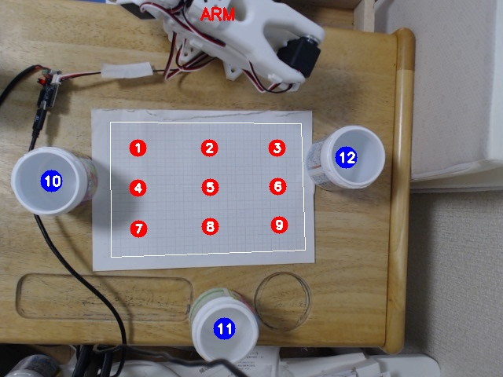
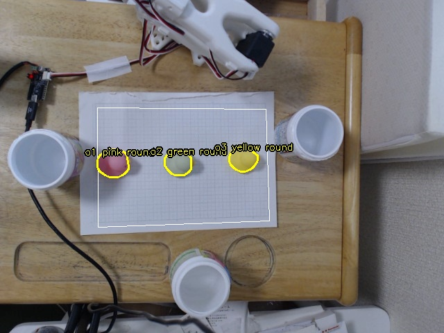
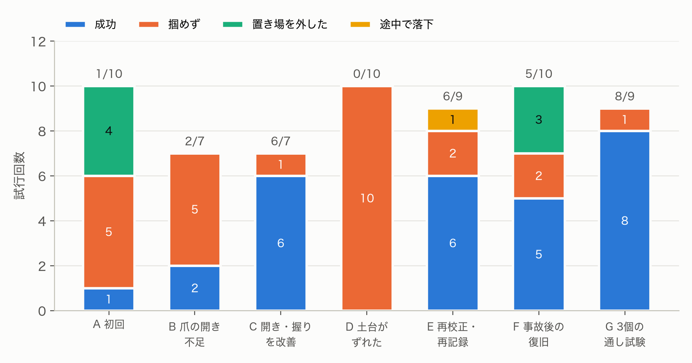

# 1. 概要

日本語で書いた仕分けルール（例：「暖色の物は左へ、寒色の物は右へ」）に従って、机の上の物体を SO-101 アームで3つのカップに仕分けるシステムを作った。物体の検出は真上のカメラと色の処理で行い、どの物をどこへ運ぶかの判断を LLM（Claude Fable 5.1）に任せた。アームの動きは学習させず、人が教えた姿勢を補間して作った。

| 項目 | 結果 |
|---|---|
| ルール判断の一括評価（12ルール・108回） | 答えが一つに決まる 197 件はすべて正解 |
| 実機の通し試験（3ルール × 3個） | 9個中 8個を正しいカップへ運んだ |
| 実機の全試行 | 62回（成功 28、掴めず 26、置き場を外した 7、途中で落下 1） |

- 動画：2分55秒（試行の場面は2倍速）
- コード：https://github.com/Indy-ai86/so101-language-sorter

# 2. しくみ

{width=55%}

処理は4段階で、どれも学習を使わない。

1. **検出**：真上のカメラ（C920）で1枚撮り、色の範囲で物体を切り出す。方眼紙の枠の四隅で画像と机の座標（cm）を対応づけ、物体ごとに色・形（丸い／角ばっている）・大きさ・位置を出す。
2. **判断**：検出結果を JSON にして、ルール文と一緒に LLM に渡す。LLM は物体ごとに置き場（左・中央・右）と自信（0〜1）を返す。返す形は JSON スキーマで固定した。画像は渡さず、検出結果の文字情報だけで判断させている。
3. **動作**：方眼の 3×3 の点で、リーダーアームを使って「掴む姿勢」を教えた。物体の位置に応じて、周りの4点の関節角を双線形補間して掴む姿勢を作る。逆運動学は使っていない。
4. **記録**：撮影した状態、LLM の判断、実機の成否を、試行ごとにファイルへ残す。集計は evaluate.py で再現できる。

{width=55%}

# 3. 工夫した点

**判断と動作を分けた。** 「どこへ運ぶか」は LLM、「どう掴むか」は教えた姿勢の補間、と役割を分けた。LLM の判断は実機なしでまとめて評価でき、実機の失敗と判断の失敗を切り分けられる。

**自信の値を返させた。** ルールが物体に当てはまるか曖昧なとき、LLM は低い自信を返す。`--min-conf` を付けると、自信が低い物は運ばずに残す。

**失敗のたびに安全策をコードに足した。** 実機で起きた失敗ごとに、再発を防ぐ仕組みを入れた。

| 起きたこと | 足した仕組み |
|---|---|
| 掴みに行く途中で腕がカップを払った | 物を持たない移動は、畳んだまま旋回してから伸ばす |
| 離した後、開いた爪がカップに掛かり、カップごと運んだ | 離した後に爪を閉じてから上へ抜く。置き場だけを物なしで試す `--test-bins` |
| 方眼の点を縦横入れ替えて記録した | 番号付きの地図を出す。記録後に関節角の並びを自動点検して警告する |
| 撮影後に物を置き替えて、別の位置を掴みに行った | 撮影から動作完了まで物に触らない運用を決めた |
| 土台が滑って、全部の姿勢がずれた | 画像の固定物を比べて、何が動いたかを特定する手順を作った |

# 4. 実験1：ルール判断の一括評価

実機を動かさずに、撮影した9つの状態（物体1〜5個）に12ルールを当てはめ、108回判断させた。費用は合計 3.38 ドル、1回あたり平均 5.3 秒だった。

正解は、ルール文から一つに決まる場合だけ決めた。ルールが想定していない色（例：暖色・寒色のルールでの黒）、境目に近い位置、矛盾や主観を含むルールは採点から外した。採点基準は evaluate.py に書いてある。

| ルール | 内容 | 正解 | 採点外 | 自信の平均 |
|---|---|---|---|---|
| r01 | ピンクを含む物は左、他は右 | 27/27 | 0 | 0.96 |
| r02 | 丸い物は中央、他は左 | 27/27 | 0 | 0.97 |
| r03 | 黄は右、青は左、他は中央 | 27/27 | 0 | 0.96 |
| r04 | 暖色は左、寒色は右 | 23/23 | 4 | 0.88 |
| r05 | 机の下半分は中央、上半分は右 | 15/15 | 12 | 0.85 |
| r06 | 2色以上は中央、単色の赤は左、他は右 | 27/27 | 0 | 0.88 |
| r07 | ピンクは左、丸い物は中央（矛盾） | 採点外 | 27 | 0.76 |
| r08 | 食べ物に見える物は右（主観） | 採点外 | 27 | 0.53 |
| r09 | 信号機の色に従う | 15/15 | 12 | 0.71 |
| r10 | 一番大きい物だけ右 | 9/9 | 18 | 0.90 |
| r11 | 緑は中央、他は丸ければ左・角ばれば右 | 27/27 | 0 | 0.95 |
| r12 | 左端に近い物ほど左（解釈が要る） | 採点外 | 27 | 0.79 |

答えが決まる 197 件はすべて正解だった。答えが決まらないルールでは、自信が下がった。食べ物かどうかを問う r08 は平均 0.53 で最も低い。r09 では、ピンクの物を8回とも「止まれの色」として左へ送ったが、自信は 0.40〜0.60 にとどまった。矛盾する r07 では、ピンクで丸い物を8回とも先に書かれたルールに従って左へ送り、自信は 0.55〜0.60 だった。

# 5. 実験2：実機での仕分け

{width=95%}

| 段階 | 成功 | 主な失敗の原因 | 対策 |
|---|---|---|---|
| A 初回 | 1/10 | 方眼の点を縦横入れ替えて記録。置き場が低く、カップの縁に当たった | 記録を直した。置き場の真上へ寄ってから下ろす |
| B 爪の開き不足 | 2/7 | 記録時の爪の開きがアヒルの幅とほぼ同じで、5mm ずれると爪が乗り上げた。握りも甘かった | 近づくときだけ爪を大きく開く。記録値より深く握る |
| C 開き・握りを改善 | 6/7 | 下寄りの位置で、腕がカップに接触 | 畳んで旋回してから伸ばす |
| D 土台がずれた | 0/10 | カップへの接触で、アームの土台と紙が 2〜3cm 滑った。気づかずに記録をやり直して悪化した | 画像の固定物と比べて原因を特定。土台と紙を固定 |
| E 再校正・再記録 | 6/9 | 補正値で真ん中は合ったが、左右がずれた（土台が回転もしていた） | 校正→姿勢の記録の順でやり直した |
| （事故） | − | 3個の通し試験で、開いた爪がカップに掛かり、カップごと運んで土台ごと崩れた。記録し直した置き場を試さずに進めていた | 離した後に爪を閉じて抜く。`--test-bins` |
| F 事故後の復旧 | 5/10 | 置き場を爪の隙間の中心で合わせていたため、挟んだアヒルが固定側の爪に寄った分だけ外れた | 置き場はアヒルを挟んだ状態で、アヒルの中心をカップに合わせて記録する |
| G 3個の通し試験 | 8/9 | 方眼の端（教えた点の外側）の物を掴めなかった | 物を教えた点の内側に置く |

最後の通し試験では、r01・r09・r04 の3ルールで 9個中 8個を正しいカップへ運んだ。LLM の判断は9個とも期待どおりだった。

# 6. 考察

**失敗はすべて位置合わせに由来した。** 62回の試行で、LLM の判断が原因の失敗はなかった。失敗の原因は、姿勢の記録、カメラの校正、土台の固定、爪の形のどれかだった。言葉のルールを解釈する部分より、カメラとアームと机の位置関係を保つ部分の方が、はるかに難しかった。

**補正値の継ぎ足しには限界がある。** 土台が動いた後、ずれを一律の補正値で打ち消そうとしたが、真ん中を合わせると左右がずれた。土台が平行に動くだけでなく回転もすると、ずれ方が位置ごとに変わるためだ。「固定 → 校正 → 姿勢の記録」の順にやり直すと、一度で通った。

**爪が左右対称でないことが効いた。** SO-101 の爪は片方が固定で、もう片方だけが動く。爪を大きく開いても、ずれが固定側に出ると固定側の爪がアヒルに乗る。置き場でも、挟んだアヒルは固定側に寄る。狙う位置を固定側から少し離す、置き場はアヒルそのものを合わせて記録する、の2つで解決した。

**事故は確認の手順の抜けから起きた。** 置き場を記録し直した後、そのカップを試さずに3個の通し試験へ進めた。変えた所は、物を運ぶ前に単独で試す手順を必ず挟むべきだった。

**判断の迷いは自信の値に出た。** 答えが決まらないルールほど自信が下がった。自信の低い物を運ばずに残す運用は、人に確認を求める仕組みとして使える。

# 7. AI の使い方

- **判断**：Claude Fable 5.1 を、Claude Code のヘッドレス実行（`claude -p`）で呼んだ。ツールは使わせず、JSON スキーマで出力形式を固定した。
- **開発**：コードの作成、失敗の原因調査（画像の比較など）、集計、動画の編集に Claude Code を使った。

# 8. 今後

- 型付きの確率判断モデル（Jev）や GPT-6 Astra と、同じ状態・ルールで判断を比べる
- 物体の種類（アヒル、箱など）を記録して、食べ物かどうかのような意味のルールを試す
- 逆運動学で姿勢を計算し、教える手間と位置合わせの誤差を減らす

# 付録：再現手順

```
python calibrate.py --points <四隅>      # カメラと机の対応づけ
python teach.py --only grid,bin --fix-roll 20.8 --fix-gripper   # 姿勢を教える
python teach.py --test-bins             # 置き場を物なしで試す
python decide.py runs/<日付>/states.jsonl   # 判断の一括評価
python sort.py --rule r01 --step --judge    # 実機で仕分け
python evaluate.py                       # 集計
```
