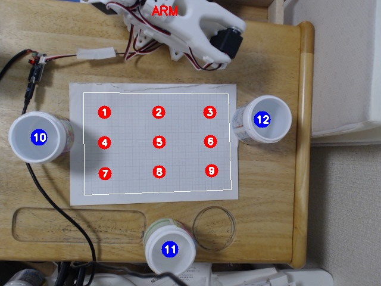
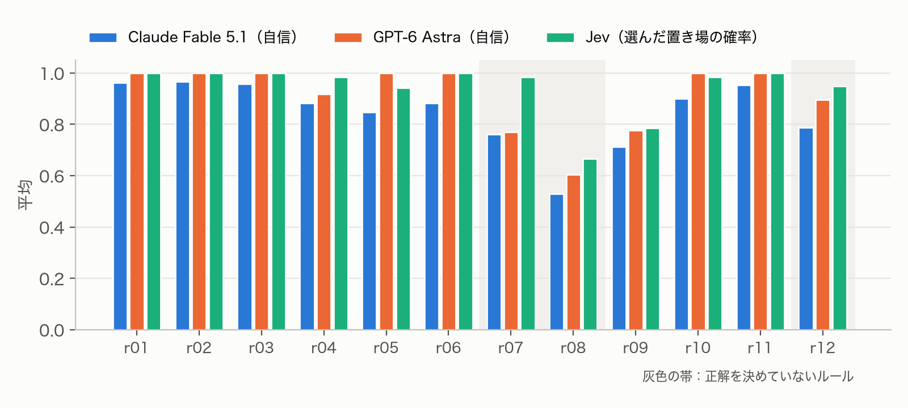
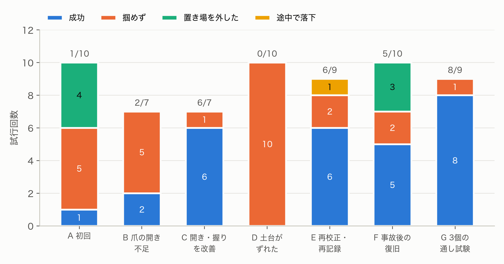

# 1. 概要

日本語で書いた仕分けルール（例：「暖色の物は左へ、寒色の物は右へ」）に従って、机の上の物体を SO-101 アームで3つのカップに仕分けるシステムを作った。物体の検出は真上のカメラと色の処理で行い、どの物をどこへ運ぶかの判断をモデルに任せた。アームの動きは学習させず、人が教えた姿勢を補間して作った。

vol.5 では、判断を担うモデルを3つ用意し、同じ日に同じ条件で比べた。文章を生成する LLM の Claude Fable 5.1 と GPT-6 Astra、そして選択肢ごとの確率を返す判断専用モデルの Jev（TypeSafe）である。検出とアームの動きは共通で、判断だけを替えた。

| 項目 | Claude Fable 5.1 | GPT-6 Astra | Jev 1.14 |
|---|---|---|---|
| ルール判断の一括評価（12ルール・108回） | 答えが決まる 197 件すべて正解 | 197 件すべて正解 | 197 件すべて正解 |
| 判断1回の時間（一括評価の平均） | 5.3 秒 | 5.3 秒 | 0.18 秒 |
| 一括評価 108 回の費用 | 3.38 ドル | 定額の利用枠（1回 約 15,000 トークン） | 0.004 ドル |
| 実機の通し試験（3ルール × 3個、同じ日） | 9個中 9個 | 9個中 9個 | 9個中 9個 |
| 信号機のルールでピンクを | 「赤」とみなして左へ | 「赤」とみなして左へ | 「赤」とみなさず右へ |

- 動画：2分53秒（3つのモデルを並べた比較の場面は2倍速。音は撮影時の音と BGM）
- コード：https://github.com/Indy-ai86/so101-language-sorter

# 2. しくみ

{width=50%}

処理は4段階で、どれも学習を使わない。

1. **検出**：真上のカメラ（C920）で1枚撮り、色の範囲で物体を切り出す。方眼紙の枠の四隅で画像と机の座標（cm）を対応づけ、物体ごとに色・形・大きさ・位置を出す。
2. **判断**：検出結果を JSON にして、ルール文と一緒に判断モデルに渡す。モデルは物体ごとに置き場（左・中央・右）と、その確からしさを返す。画像は渡さず、検出結果の文字情報だけで判断させている。
3. **動作**：方眼の 3×3 の点で、リーダーアームを使って「掴む姿勢」を教えた。物体の位置に応じて、周りの4点の関節角を双線形補間して掴む姿勢を作る。逆運動学は使っていない。
4. **記録**：撮影した状態、判断、実機の成否を、試行ごとにファイルへ残す。集計は evaluate.py で再現できる。

**3つの判断モデルへの問い方。** 指示文・ルール文・物体の一覧は、3つとも同じ文面で渡した。違うのは呼び方と答えの受け取り方である。

| | Claude Fable 5.1 | GPT-6 Astra | Jev（TypeSafe System One） |
|---|---|---|---|
| 呼び方 | Claude Code のヘッドレス実行（`claude -p`） | Codex CLI のヘッドレス実行（`codex exec`） | HTTP API（`POST /v1/systemone`） |
| 答えの形 | JSON スキーマで、全物体の置き場と自信（0〜1）を一度に返させる | 同左 | 物体1個につき「左・中央・右」の選択式の質問を1つ立て、3つの確率を返させる |
| 確からしさ | モデルが自分で申告する自信 | 同左 | 各置き場の確率。選んだ置き場の確率を使う |

Fable と Astra は、それぞれのコーディング用 CLI をツールなしで呼び、出力を JSON スキーマで固定した。Astra は Codex がエージェント用の前置きを毎回付けるため、1回の入力が約 15,000 トークンになった（Jev は約 900 トークン）。Jev は文章を生成せず、質問ごとに選択肢の確率だけを返す。同じ場面の全物体についての質問を、1回の呼び出しでまとめて送った。

# 3. 工夫した点

**判断と動作を分けた。** 「どこへ運ぶか」は判断モデル、「どう掴むか」は教えた姿勢の補間、と役割を分けた。判断は実機なしでまとめて評価でき、実機の失敗と判断の失敗を切り分けられる。vol.5 では、この分け方のおかげで判断モデルだけを差し替えて比べられた。判断先は `--backend fable|astra|jev` で切り替える。

**確からしさを返させた。** ルールが物体に当てはまるか曖昧なとき、モデルは低い値を返す。`--min-conf` を付けると、値が低い物は運ばずに残す。

**失敗のたびに安全策をコードに足した。** 実機で起きた失敗ごとに、再発を防ぐ仕組みを入れた。

| 起きたこと | 足した仕組み |
|---|---|
| 掴みに行く途中で腕がカップを払った | 物を持たない移動は、畳んだまま旋回してから伸ばす |
| 離した後、開いた爪がカップに掛かり、カップごと運んだ | 離した後に爪を閉じてから上へ抜く。置き場だけを物なしで試す `--test-bins` |
| 方眼の点を縦横入れ替えて記録した | 番号付きの地図を出す。記録後に関節角の並びを自動点検して警告する |
| 土台が滑って、全部の姿勢がずれた | 画像の固定物を比べて、何が動いたかを特定する手順を作った |
| 左端の点で、爪がいつもカップ側に下りた | 列ごとにずらす量を変えられるようにした |
| 置き場に入らなくなった原因が分からなかった | 置き場の単独試験で、下ろした所の関節角と指令との差を表示する |

# 4. 実験1：ルール判断の一括評価

実機を動かさずに、撮影した9つの状態（物体1〜5個）に12ルールを当てはめ、各モデルに108回ずつ判断させた。正解は、ルール文から一つに決まる場合だけ決めた。ルールが想定していない色、境目に近い位置、矛盾や主観を含むルールは採点から外した。採点基準は evaluate.py に書いてある。

| ルール | 内容 | 正解（3モデル） | 採点外 | Fable 自信 | Astra 自信 | Jev 確率 |
|----|------------------------|--------|-----|-----|-----|-----|
| r01 | ピンクを含む物は左、他は右 | 27/27 | 0 | 0.96 | 1.00 | 1.00 |
| r02 | 丸い物は中央、他は左 | 27/27 | 0 | 0.97 | 1.00 | 1.00 |
| r03 | 黄は右、青は左、他は中央 | 27/27 | 0 | 0.96 | 1.00 | 1.00 |
| r04 | 暖色は左、寒色は右 | 23/23 | 4 | 0.88 | 0.92 | 0.98 |
| r05 | 机の下半分は中央、上半分は右 | 15/15 | 12 | 0.85 | 1.00 | 0.94 |
| r06 | 2色以上は中央、単色の赤は左、他は右 | 27/27 | 0 | 0.88 | 1.00 | 1.00 |
| r07 | ピンクは左、丸い物は中央（矛盾） | 採点外 | 27 | 0.76 | 0.77 | 0.98 |
| r08 | 食べ物に見える物は右（主観） | 採点外 | 27 | 0.53 | 0.60 | 0.67 |
| r09 | 信号機の色に従う | 15/15 | 12 | 0.71 | 0.78 | 0.79 |
| r10 | 一番大きい物だけ右 | 9/9 | 18 | 0.90 | 1.00 | 0.98 |
| r11 | 緑は中央、他は丸ければ左・角ばれば右 | 27/27 | 0 | 0.95 | 1.00 | 1.00 |
| r12 | 左端に近い物ほど左（解釈が要る） | 採点外 | 27 | 0.79 | 0.89 | 0.95 |

{width=92%}

**答えが決まる物では差がなかった。** 3モデルとも 197 件すべて正解で、答えは一致した。

**分かれたのは、答えが決まらない物だけだった。** 324 個のうち置き場が分かれた数は、Fable と Astra で 12 個、Fable と Jev で 27 個、Astra と Jev で 27 個だった。すべて採点外の物である。Astra の判断は Fable に近く、Jev とは離れていた。

| ルール | 分かれ方 |
|---|---|
| r09 信号機 | ピンクを、Fable と Astra は8回とも信号機の「赤」（止まれ）とみなして左へ送った。Jev はそうせず、中央4・左2・右2 と割れた。黒は、Fable が左と右に半々、Astra が4回とも中央、Jev がほぼ左と、3つともばらばらだった |
| r08 食べ物 | 緑のアヒルを、Fable と Astra はほぼ「食べ物」として右へ、Jev は多く左へ送った。ピンクは3つとも左右に割れた |
| r05 境目 | 縦の中ほどにある物を、Fable と Astra は右、Jev は中央へ |
| r12 左端 | 真ん中付近の物の扱いが分かれた |

**確からしさの出し方が違った。** Jev は全体に高い値を返した。特に矛盾するルール r07 では、Fable と Astra の自信が 0.5〜0.6 に下がったのに対し、Jev はピンクで丸い物を確率 0.91〜0.98 で左へ送った。Fable と Astra はルール同士がぶつかっていることを値の低さで示したが、Jev は示さなかった。一方、境目の位置を問う r05 では、Astra は自信 1.00 のままで、Fable（0.85）ほど下げなかった。自信が下がる場面は、LLM どうしでも同じではない。Jev の確率は3つの置き場への分布として返るので、どの置き場で迷っているかまで見える。

なお Jev が返す confidence は、分布がどれだけ一つに偏っているかを表す値で、選んだ答えが正しい確率ではない。上の比較では、選んだ置き場の確率を使った。

# 5. 実験2：実機での仕分けの改善（Fable）

{width=90%}

| 段階 | 成功 | 主な失敗の原因 | 対策 |
|---|---|---|---|
| A 初回 | 1/10 | 方眼の点を縦横入れ替えて記録。置き場が低く、カップの縁に当たった | 記録を直した。置き場の真上へ寄ってから下ろす |
| B 爪の開き不足 | 2/7 | 記録時の爪の開きがアヒルの幅とほぼ同じで、5mm ずれると爪が乗り上げた | 近づくときだけ爪を大きく開く。記録値より深く握る |
| C 開き・握りを改善 | 6/7 | 下寄りの位置で、腕がカップに接触 | 畳んで旋回してから伸ばす |
| D 土台がずれた | 0/10 | 接触で土台と紙が 2〜3cm 滑った。気づかずに記録をやり直して悪化した | 画像の固定物と比べて原因を特定。土台と紙を固定 |
| E 再校正・再記録 | 6/9 | 補正値で真ん中は合ったが、左右がずれた（土台が回転もしていた） | 校正→姿勢の記録の順でやり直した |
| （事故） | − | 開いた爪がカップに掛かり、カップごと運んで土台ごと崩れた | 離した後に爪を閉じて抜く。`--test-bins` |
| F 事故後の復旧 | 5/10 | 置き場を爪の隙間の中心で合わせていたため、挟んだアヒルが固定側に寄った分だけ外れた | 置き場はアヒルを挟んだ状態で記録する |
| G 3個の通し試験 | 8/9 | 方眼の端の物を掴めなかった | 左端の狙いを直した（実験3） |

62回の試行で、判断が原因の失敗はなかった。失敗はすべて、姿勢の記録、カメラの校正、土台の固定、爪の形のどれかだった。

# 6. 実験3：実機での比較（Fable・Astra・Jev）

実験2の最後の通し試験（10/25、段階 G）と同じルール・同じ並べ方で、11/1 に3つのモデルで運ばせた。並べ方は、方眼の真ん中の行の3点に1個ずつである。

**比べる前に直したこと。** 1週間空いたので、物を運ぶ前に変化を調べ、変えた所を単独で試してから進めた。

| 見つかったこと | 対処 | 確かめ方 |
|---|---|---|
| 土台の板ごと、カメラから見て約 1cm 動いていた。机の外の物は動いていない | 紙の四隅を前回の画像と照合し、校正だけを合わせ直した | 四隅の一致度 0.96〜0.99 |
| 中央のカップ（置き場 11）で、爪がカップに触れた | 下ろす高さを肩の角度で2度（約 8mm）上げた | `--test-bins` で触れずに抜けた |
| 左端の点で、爪がアヒルよりカップ側に下りて掴めなかった | 左端の列だけ、狙いをずらす量を 0.5cm から 1.2cm にした | 把持確認で真上に下りた |

左端の直し方は一度で決まらなかった。最初はずれの向きを逆に読み、狙いをカップ側へ動かして悪化させた。教えた点の外側へ狙いを延長する方法も試したが、延長した狙いはどちらもカップ側に外れた。結局、ずらす量を増やし、外側の物も左端の点を狙う形に落ち着いた。

**運んだ順番。** 午前に Jev で運びながら上のアームの調整をした。調整を終えた状態で、午後に Fable、続けて Jev の r01 と r09 を運んだ。その後、置き場 10 と 11 を記録し直してから（後述）、Astra で運んだ。表の Jev の r04 は、午前の調整後の回である。

**結果。**

| ルール | 物体（左から） | Fable | Astra | Jev |
|---|---|---|---|---|
| r01 | ピンク・緑・黄 | 左・右・右　3/3 | 左・右・右　3/3 | 左・右・右　3/3 |
| r09 | 緑・黄・ピンク | 右・中央・**左**（自信 0.40）　3/3 | 右・中央・**左**（自信 0.55）　3/3 | 右・中央・**右**（確率 0.73）　3/3 |
| r04 | 緑・ピンク・黄 | 右・左・左　3/3 | 右・左・左　3/3 | 右・左・左　3/3 |
| 判断の時間 | | 4.0〜6.3 秒 | 5.4〜6.0 秒 | 0.17〜0.21 秒 |

判断は、答えが決まる物ですべて一致し、運んだ結果も3つとも 9/9 だった。

**分かれたのは r09 のピンクだけだった。** 信号機の色にないピンクを、Fable と Astra は信号機の「赤」（止まれ）とみなして左へ送った。Jev は赤とみなさず、右（進め）へ送った。どのモデルも確からしさは高くない。どのモデルも、別の回でも同じ置き場を選んだ。Fable は 10/25 にも左（自信 0.40）、Jev は午前にも右（確率 0.48）だった。Astra は一括評価で8回とも左だった。

**アームの動きはモデルに依らない。** 1個を運ぶ時間は、どのモデルでも 25〜30 秒だった。腕の通り道・速さ・加減速は共通のコードが決めているためで、モデルが決めるのは置き場だけである。10/25 の Fable（8/9）で掴めなかった左端の緑は、左端の狙いを直した後は、どのモデルでも掴めた。

**同じ日の中でも、置き場が合わなくなった。** 午後に Jev の r04 も取り直そうとしたところ、置き場 10（左のカップ）で外れる回が続いた。判定まで進んだ5回のうち4回で、ピンクか黄がカップの外に落ちた。それまでは、置き場 10 への運び込みは9回すべて成功していた。カメラの画像では、カップ・紙・机・アームの根元は動いていなかった。置き場に下ろした所で関節角を測ると、3つの置き場とも指令との差は同じで（肘が約 2 度、ほかは 0.5 度以内）、モーターは指令どおりに届いていた。原因は特定できていない。真上のカメラにも関節角にも映らない変化（モーターと腕の取り付けのわずかなずれ、カップの高さや傾き）と考えている。置き場 10 と 11 を記録し直すと単独試験が通り、Jev の r04 で3個とも入ることを確かめてから Astra に進んだ。このため、Astra だけは新しい置き場の姿勢で運んでいる。判断の比較には影響しない。

Jev では、ほかにも調整の途中で2回運んでおり、どちらも記録に残した。直す前の r01 は 2/3（左端のピンクが掴めず）、左端を直す途中の r04 は 1/3（左端の緑が掴めず、中央のピンクを途中で落とした）だった。

# 7. 考察

**明確なルールでは、判断モデルを替えても結果は変わらなかった。** 答えが決まる物では、一括評価でも実機でも3つのモデルは一致し、誤りはなかった。同じ日に運ばせると、運んだ結果も3つとも 9/9 だった。このシステムで難しいのは言葉の解釈ではなく、カメラとアームと机の位置関係を保つことだった。この結論は vol.1 と同じで、モデルを替えても変わらなかった。

**モデルの差は、曖昧な物の扱いに出た。** 信号機の色にないピンクを「赤」とみなすか、食べ物かどうか、境目の位置で、置き場が分かれた。2つの LLM（Fable と Astra）は互いに近く、判断専用モデルの Jev は別の答えを選びやすかった。LLM はピンクを赤の仲間と読み替えてルールに当てはめにいき、Jev はそうしなかった、と言える。どちらが正しいとは言えないので、曖昧な物は運ばずに人に確認する運用が向く。そのためには、確からしさが曖昧さを正しく映している必要がある。

**確からしさの意味がモデルごとに違う。** Fable と Astra の自信は、矛盾するルール（r07）で下がった。Jev の確率は全体に高く、矛盾には反応しなかった。一方で、境目の位置（r05）では Astra の自信は下がらなかった。Jev は3つの置き場への分布を返すので、どの置き場で迷っているかまで分かる。`--min-conf` のしきい値は、モデルごとに決め直す必要がある。

**速さと費用では Jev が大きく上回った。** 判断の時間は Fable と Astra の約 30 分の 1、費用は Fable の約 800 分の 1 だった。Astra は定額の利用枠で使えたが、Codex の前置きのために1回の入力が Jev の約 16 倍になった。このシステムでは、1個を運ぶのに 25〜30 秒かかるので、判断の 5 秒は全体を大きくは遅らせない。ただし、判断の回数が多い使い方や、待ち時間が目立つ使い方では差が効く。

**位置合わせは時間がたつと崩れる。** 1週間空いただけで、土台が 1cm 動き、中央のカップの高さが合わなくなっていた。本番の前に、固定物との画像比較、置き場の単独試験、把持確認の3つを挟んだので、物を運ぶ前に直せた。同じ日の中でも、数時間動かした後に置き場 10 が合わなくなった。教えた姿勢をそのまま再生する方式は、こうした変化を自分では検出できない。置いた結果をカメラで確かめる仕組みが要る。

**言葉での位置の伝え方に落とし穴があった。** 左端の調整では、「やや左寄り」という報告を、座っている位置から見た左右（カメラ画像と鏡写し）だと決めつけて、逆向きに直した。近くのカップを目印に聞き直して、正しい向きが分かった。

# 8. AI の使い方

- **判断（Fable）**：Claude Fable 5.1 を、Claude Code のヘッドレス実行（`claude -p`）で呼んだ。ツールは使わせず、JSON スキーマで出力形式を固定した。
- **判断（Astra）**：GPT-6 Astra を、Codex CLI のヘッドレス実行（`codex exec`）で呼んだ。読み取り専用で、JSON スキーマで出力形式を固定した。
- **判断（Jev）**：TypeSafe の System One API に、物体ごとの選択式の質問として送った。
- **開発**：コードの作成、失敗の原因調査（画像の比較など）、集計、動画の編集に Claude Code を使った。

# 9. 今後

- 動かしている最中の関節角を記録し、速さ・振動・目標との誤差を測る。モデルに依らずアームの動きが同じことを、データで示せる
- 置いた結果をカメラで確かめ、置き場のずれを自分で検出する
- 確からしさのしきい値をモデルごとに決め、曖昧な物を人に確認する運用を試す
- 逆運動学で姿勢を計算し、教える手間と位置合わせの誤差を減らす

# 付録：再現手順

```
python calibrate.py --points <四隅>      # カメラと机の対応づけ
python teach.py --test-bins             # 置き場を物なしで試す（指令との差も表示）
python check_grasp.py                    # 掴む位置を物 1 個で確かめる
python decide.py runs/<日付>/states.jsonl --backend astra   # 判断の一括評価（fable / astra / jev）
python sort.py --rule r01 --backend jev --step --judge      # 実機で仕分け
python evaluate.py                       # 集計（判断先ごと、分かれた物の一覧）
```

Jev を使うには、TypeSafe の API キーを環境変数 `TYPESAFE_API_KEY` か `keys.env` に置く。Astra は Codex CLI にログインしたアカウントで呼ぶ。

<p class="credit">動画の BGM：CMSL クラシック名曲サウンドライブラリー「ラストシンフォニー」のライセンスフリー素材音源（チャイコフスキー「白鳥の湖」第2幕 情景、https://classical-sound.seesaa.net/article/464440694.html）</p>
